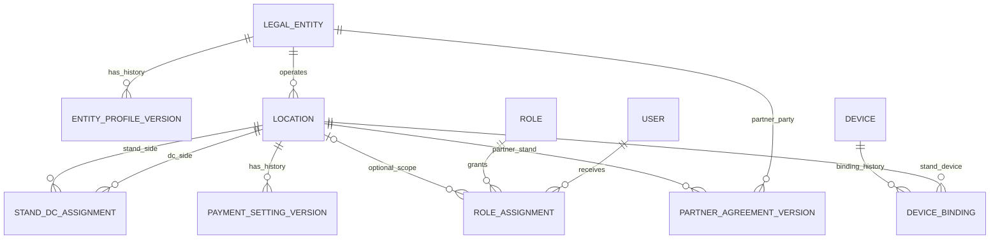
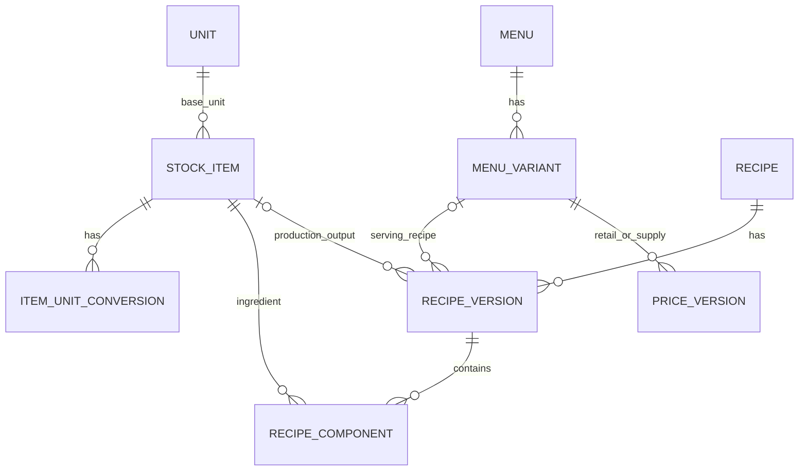
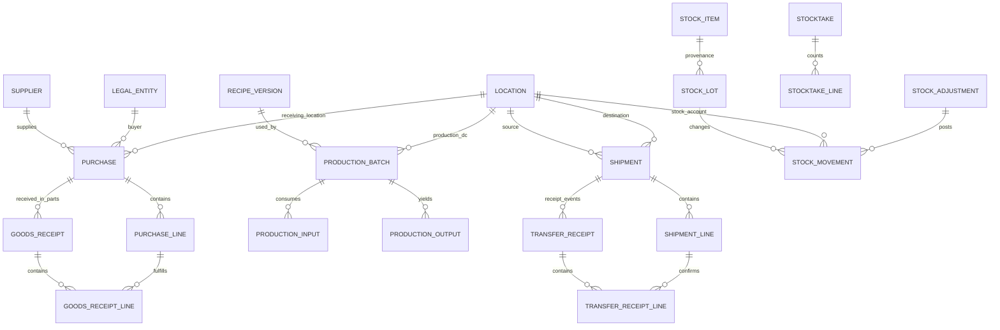
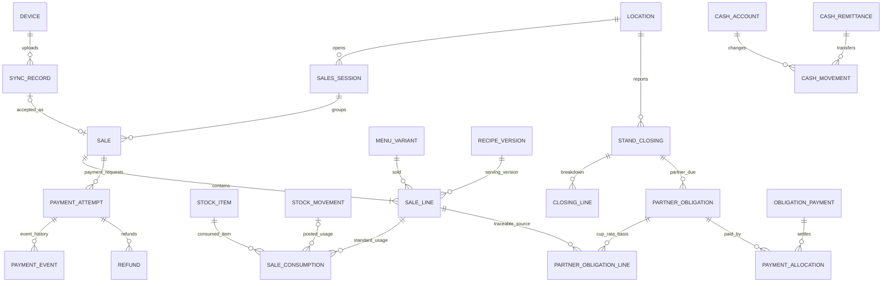

# Teh Coyo — Blueprint Aplikasi v0.1

**Status: rancangan konseptual untuk ditinjau, bukan skema database final atau kode yang sudah berjalan.** Pengguna menyetujui pembuatan blueprint. Persetujuan ini tidak otomatis menetapkan seluruh detail akuntansi, pajak, approval, formula, atau harga yang masih terbuka.

Baca bersama:

- `PROJECT_CONTEXT.md`: kebutuhan dan keputusan bisnis.
- `IMPLEMENTATION_PLAN.md`: fase pengembangan dan rancangan sinkronisasi.
- `RECIPE_DESIGN.md`: konfigurasi resep produksi dan penyajian.
- `AGENTS.md`: aturan kerja implementasi.

Nama model, field, endpoint dan status di bawah adalah usulan. Tidak ada ORM, scaffold, migrasi atau library tambahan yang dipilih melalui dokumen ini. **Pembaruan setelah blueprint:** pengguna kemudian menyetujui paket pendukung dan scaffold irisan fondasi telah dibuat; lihat `README.md` untuk fitur/perintah yang benar-benar tersedia. Diagram blueprint tetap rancangan jangka lanjut, bukan skema aktual semua fitur.

## 1. Peta keputusan

**Kemajuan setelah discovery:** Stok Dasar disetujui/dibuat; ledger jumlah, opening/receipt/adjustment serta transfer kirim/terima parsial. Rincian aktual dan batas role/tanggal/retur di `docs/INVENTORY_BASELINE.md`, tidak otomatis seluruh blueprint. Tidak mengimpor Accurate atau membuat saldo DC bayangan. Ini menggantikan catatan "belum persetujuan implementasi modul berikutnya" untuk irisan Stok Dasar saja.

**Kemajuan pembelian:** user meminta lanjut; supplier, nota barang, terima actual/link stock existing, declared payments dan sisa tagihan sudah dibuat. `docs/PURCHASING_BASELINE.md` adalah kontrak implementasi aktual, bukan semua ERD di bawah. Belum kas/bank/GL/HPP/tax/retur, belum pembelian mitra/kasir. Tidak menciptakan penjualan internal atau mengimpor Accurate.

**Klarifikasi terbaru existing vs target setelah ekspor dipelajari:** fungsi DC **sudah berjalan** (meracik teh lalu mengirim ke stand), tetapi masih **satu titik fisik bersama pusat**, dengan pencatatan operasional dan keuangan di kertas. Yang direncanakan adalah pemisahan ke beberapa DC wilayah/alokasi stand. Accurate bukan seluruh sumber histori. Pusat/DC dapat direpresentasikan sebagai unit pencatatan berbeda pada alamat sama, masih satu entitas, setelah batas stok/kas/tanggung jawab dikonfirmasi. Jangan menghitung fisik stok yang sama sebagai dua saldo atau membuat histori/parent fiktif. Semua nama stand existing berawalan MITRA tanpa membedakan kepemilikan. Bypass pasokan tanpa DC tidak diminta; tidak perlu mengubah controller hierarki hanya dari keterbatasan ekspor. Penugasan wilayah masa depan perlu mempertahankan histori.

**Arah lanjutan pengguna:** DC existing dapat dianggap "bayangan"/fungsi yang menyatu dengan pusat; data kurang lebih seperti Accurate. Catatan paper **opsional dan bukan prasyarat development**. Rancang alur standar ke depan dengan ekspor sebagai acuan master/struktur, bukan upaya wajib merekonstruksi pembukuan lama. Pemisahan saldo pusat/DC aktual belum diwajibkan. Konversi, tarif/kewajiban mitra dan saldo pilot tetap perlu verifikasi sebelum digunakan, bukan ditebak dari rumus standar. Ini belum persetujuan implementasi modul berikutnya.

### 1.1 Sudah disepakati/dikonfirmasi

| Area              | Pegangan desain                                                                                                                                                                                                     |
| ----------------- | ------------------------------------------------------------------------------------------------------------------------------------------------------------------------------------------------------------------- |
| Struktur usaha    | Pusat, seluruh DC dan stand sendiri satu entitas. Stand mitra milik pihak lain. DC biasanya menangani 5–10 stand.                                                                                                   |
| Arus internal     | DC mengajukan barang dan membayar cash ke pusat secara operasional; catat stok/kas per lokasi tanpa menjadikan transfer internal omzet eksternal gabungan.                                                          |
| Produksi          | DC memproduksi teh dasar dari bahan pusat. Stand menambahkan powder saat pelanggan memesan.                                                                                                                         |
| Penjualan         | Per cup minuman dan varian rasa; bukan tagihan bahan satu per satu. Cup kosong adalah item stok yang berbeda dari menu minuman.                                                                                     |
| Penyelesaian      | Stand sendiri mempertanggungjawabkan seluruh penerimaan penjualan; mitra hanya membayar pasokan untuk cup yang terjual. Barang sisa tidak otomatis diretur atau dibayar.                                            |
| Harga pasokan     | Prinsip harga dikunci saat penerimaan dan FIFO disetujui. **Penerapan ke paket per cup dari beberapa bahan masih terbuka**; prinsip ini tidak cukup untuk mengarang algoritma tagihan.                              |
| Pembelian lokal   | DC dan stand boleh membeli dari supplier eksternal/lokal; sumber dana dan approval masih perlu aturan. Belanja mitra tidak otomatis menjadi biaya pusat/DC.                                                         |
| Resep             | Admin terkait perlu dapat mengisi komponen, satuan, takaran/output dan perhitungan; angka nyata belum diketahui. Editor tabel/scaling merupakan rancangan awal, ekspresi lanjutan perlu validasi.                   |
| Perangkat/offline | Satu stand satu HP Android; DC/mitra kemungkinan tablet. Penjualan cash harus tetap dicatat offline dan otomatis dicoba sync ketika koneksi tersedia.                                                               |
| Pembayaran        | Stand configurable cash-only atau cash+QRIS oleh admin berwenang. Midtrans provider pertama di belakang adapter; calon Xendit tidak mengubah domain POS. QRIS dinamis membutuhkan jaringan dan verifikasi provider. |
| Historis          | Identitas/aturan pajak berversi dan snapshot transaksi; perubahan ke depan tidak menimpa laporan lama. UMKM bukan pilihan bentuk hukum yang berlawanan dengan PT/CV.                                                |
| Stack             | React/TypeScript/Vite PWA, IndexedDB, NestJS REST API/OpenAPI, PostgreSQL, modular monolith, satu repository, satu pengembang.                                                                                      |

### 1.2 Belum boleh dianggap final

- Tarif per varian/ukuran, cakupan harga paket, pemetaan penerimaan bahan ke lapisan tarif per cup/FIFO.
- Kontrak mitra: pemilik legal stok titipan, waktu pengakuan penjualan/tagihan, pembagian tanggungan rusak/hilang/retur.
- Resep nyata, yield, masa simpan, konversi kemasan, waste dan toleransi takaran.
- Approval limit, sumber kas belanja lokal, apakah sebagian operasi selain POS perlu offline.
- Metode HPP, laporan akuntansi formal dan aturan pajak aktual yang disahkan profesional.
- Otorisasi offline, jam HP salah, transaksi terlambat setelah tutup, pemulihan/ganti perangkat, diskon/void/refund offline.
- ORM, autentikasi, library UI/state, deployment, backup, kapasitas dan biaya.

## 2. Batas arsitektur dan data

```text
React PWA (UI kasir/admin, IndexedDB untuk antrean cash)
     │ REST API /api/v1 + OpenAPI
NestJS modular monolith
     ├─ Organization / Identity & Access
     ├─ Catalog / Recipes / Pricing
     ├─ Procurement / Production / Inventory & Distribution
     ├─ Sales / Offline Sync / Payments
     ├─ Closing & Settlement / Finance / Tax
     └─ Reporting / Audit / Import
     │
PostgreSQL                         PaymentProvider → Midtrans (Xendit kemudian)
```

- Tiap modul memiliki aturan/application service dan akses data sendiri. Pemanggilan lintas modul melalui kontrak, bukan controller yang menulis langsung ke tabel modul lain.
- Dalam satu database, finalisasi dokumen yang memengaruhi stok/uang harus atomik; tidak perlu microservices atau broker untuk memperoleh modularitas.
- Frontend bukan otoritas harga, izin, pembayaran atau stok. Backend memvalidasi input dan mempertahankan versi/snapshot; frontend hanya memakai aturan tersetujui untuk pengalaman offline.
- Ledger/mutasi dan dokumen sumber adalah jejak perubahan. Tabel saldo/cached read model boleh ditambahkan sebagai turunan yang dapat direkonsiliasi, bukan angka bebas diedit.

## 3. ERD konseptual

Diagram menggunakan Mermaid `erDiagram`. Relasi menunjukkan arah/jenis hubungan; beberapa field opsional dan rincian kardinalitas akan diperjelas pada ERD fisik. Nama model tidak menetapkan jumlah tabel final.

### 3.1 Organisasi dan akses



| Model                            | Data/peran penting                                                                                                                                                                          |
| -------------------------------- | ------------------------------------------------------------------------------------------------------------------------------------------------------------------------------------------- |
| `LegalEntity`                    | Identitas pemilik/penjual untuk Teh Coyo maupun pihak mitra. Bukan hanya badan berbentuk PT; NPWP/detail yang tidak diperlukan tidak harus diisi pada tahap awal.                           |
| `EntityProfileVersion`           | Bentuk/identitas hukum, klasifikasi/status pajak, periode efektif, approval. Entitas hukum baru dibuat terpisah bila peralihan memang mengganti subjek hukum.                               |
| `Location`                       | Pusat/DC/stand, jenis stand sendiri/mitra, entitas operator, alamat/zona waktu. Perubahan kepemilikan tidak menulis ulang transaksi lama.                                                   |
| `StandDcAssignment`              | Riwayat DC pembina stand dengan tanggal efektif; satu penugasan aktif per stand menurut kebijakan awal. Penjualan/dokumen menyimpan DC yang terkait saat kejadian, bukan selalu DC terbaru. |
| `PartnerAgreementVersion`        | Para pihak, scope stand, aturan paket/setoran/retur, tanggal efektif. Kepemilikan stok sebelum terjual wajib eksplisit, bukan disimpulkan dari lokasi penyimpanannya.                       |
| `User`, `Role`, `RoleAssignment` | Izin + cakupan entitas/DC/stand; detail skema token/session masih terbuka.                                                                                                                  |
| `Device`, `DeviceBinding`        | Identitas instalasi/perangkat, stand, status dan riwayat penggantian. Satu perangkat kasir aktif per stand; tetap perlu menangani retry/ganti HP secara aman.                               |
| `PaymentSettingVersion`          | cash-only/cash+QRIS, provider dan referensi konfigurasi merchant, waktu berlaku/aktor. Rahasia provider di server/secret manager, bukan pada perangkat.                                     |

### 3.2 Item, menu, resep dan harga



| Model                                        | Data/peran penting                                                                                                                                                                                    |
| -------------------------------------------- | ----------------------------------------------------------------------------------------------------------------------------------------------------------------------------------------------------- |
| `StockItem`                                  | Bahan mentah, teh dasar, powder, susu, cup kosong dan item lain; kode, satuan dasar, ketentuan stok/batch bila diperlukan.                                                                            |
| `Unit`, `ItemUnitConversion`                 | Dimensi massa/volume/jumlah dan konversi eksplisit per item/kemasan. Tidak mengubah gram ke ml tanpa data sah.                                                                                        |
| `Menu`, `MenuVariant`                        | Menu jual per cup; varian rasa, ukuran opsional, status aktif. Tidak membuat stok minuman jadi fiktif per rasa.                                                                                       |
| `Recipe`, `RecipeVersion`, `RecipeComponent` | Jenis produksi/penyajian, basis output, bahan/jumlah/satuan, versi dan tanggal efektif; approval. Produksi mempunyai output item stok; penyajian terhubung menu. Aturan detail di `RECIPE_DESIGN.md`. |
| `PriceVersion`                               | Jenis harga pelanggan vs tarif pasokan/internal, varian dan scope, nominal, periode efektif. Daftar tarif berversi **tidak otomatis menetapkan cara alokasi tarif ke batch pasokan**.                 |

Versi tidak diedit setelah dipakai dokumen final. Produksi/POS menyimpan versi dan snapshot yang relevan; backend memverifikasi, bukan mempercayai hasil kalkulasi klien. Resep yang belum lengkap disimpan draft, bukan takaran nol yang diam-diam aktif.

### 3.3 Pembelian, produksi dan stok



| Model                                                    | Data/peran penting                                                                                                                                                                                          |
| -------------------------------------------------------- | ----------------------------------------------------------------------------------------------------------------------------------------------------------------------------------------------------------- |
| `Purchase`, `PurchaseLine`                               | Entitas pembeli, lokasi, supplier, item stok atau pengeluaran non-stok, kuantitas/harga snapshot, mata uang, bukti dan approval. Pemesanan, penerimaan, tagihan dan pembayaran merupakan peristiwa berbeda. |
| `GoodsReceipt`, `GoodsReceiptLine`                       | Barang yang benar-benar diterima dari supplier; kuantitas/satuan/lot/kedaluwarsa bila relevan. Penerimaan sebagian tidak dianggap seluruh pesanan selesai.                                                  |
| `ProductionBatch`, `ProductionInput`, `ProductionOutput` | Resep versi, bahan aktual, output aktual vs target, batch asal, waktu, waste, operator. Bahan mentah habis di DC; stand memakai teh dasar, bukan mengurangi bahan mentah lagi.                              |
| `Shipment`, `ShipmentLine`, `TransferReceipt`            | Lokasi asal/tujuan, barang dikirim, pengakuan jumlah diterima dan status transit/selisih. Penerimaan tidak boleh diisi otomatis sama dengan kiriman tanpa verifikasi penerima.                              |
| `StockLot`, `StockMovement`                              | Asal/batch barang dan event kuantitas pada lokasi/transit, aktor, referensi dokumen, waktu. Bedakan provenance fisik lot dengan lapisan penerimaan/alokasi harga jika diperlukan.                           |
| `Stocktake`, `StocktakeLine`, `StockAdjustment`          | Stok buku saat cutoff, hitungan fisik, selisih, alasan dan persetujuan. Opname menghasilkan dokumen penyesuaian, bukan overwrite histori.                                                                   |

**Lokasi fisik tidak sama dengan pemilik legal barang.** Buku stok harus dapat membedakan asal DC vs belanja lokal mitra dan status titipan/kepemilikan yang disepakati, meskipun disimpan di stand yang sama. Jika barang tercampur secara fisik, kebijakan alokasi harus eksplisit. Detail representasi ownership/receipt layers menunggu kontrak mitra dan ERD fisik.

Untuk transfer: gudang sumber → akun transit → lokasi penerima, dengan jumlah selisih tetap berada dalam penyelesaian yang ditelusuri. Stock movement harus memiliki sumber sah (receipt, production, transfer, konsumsi penjualan, retur, koreksi); relasi typed/reference FK dirinci saat skema fisik, bukan JSON bebas yang menjadi satu-satunya bukti sumber.

### 3.4 POS, pembayaran dan penyelesaian



| Model                                           | Data/peran penting                                                                                                                                                                                                                  |
| ----------------------------------------------- | ----------------------------------------------------------------------------------------------------------------------------------------------------------------------------------------------------------------------------------- |
| `SalesSession`                                  | Shift/sesi stand dan perangkat, waktu bisnis, status. Penjualan dapat berjalan offline dengan sesi yang memenuhi kebijakan otorisasi.                                                                                               |
| `Sale`, `SaleLine`                              | Stand dan entitas penjual saat transaksi, ID klien stabil, varian/jumlah cup, harga pelanggan/diskon/pajak snapshot, versi resep, waktu perangkat, waktu server dan urutan perangkat.                                               |
| `SaleConsumption`                               | Pemakaian teoritis per bahan dari versi resep asli, kaitan stok/lot yang akhirnya dialokasikan. Offline belum diterima server bukan mutasi server yang sudah final.                                                                 |
| `SyncRecord`                                    | Tanda terima sync/retry dan payload relevan yang disimpan aman untuk accepted/needs-review/rejected; data cash nyata yang bermasalah tidak dibuang. `received` tidak sama dengan sudah diposting ke ledger.                         |
| `PaymentAttempt`, `PaymentEvent`, `Refund`      | Cash/QRIS, nominal, provider/reference, status dan event; kemungkinan beberapa percobaan untuk satu sale. QRIS sukses belakangan setelah cash menjadi kasus pembayaran lebih, bukan pendapatan kedua.                               |
| `StandClosing`, `ClosingLine`                   | Ringkasan per varian/metode, stok fisik/cutoff, cash yang dihitung, selisih dan verifikasi. Closing bukan bukti uang benar-benar telah diterima DC.                                                                                 |
| `PartnerObligation`, `PartnerObligationLine`    | Tagihan operasional per cup terjual, asal `SaleLine`, jumlah, tarif dan dasar lapisan/versi yang digunakan. Bisa pecah satu baris sale ke beberapa alokasi bila tarif FIFO benar-benar ditetapkan. **Algoritma tarif belum final.** |
| `CashRemittance`, `CashAccount`, `CashMovement` | Setoran cash, akun asal/tujuan, pengiriman/penerimaan kas internal, pengeluaran serta penerimaan supplier/mitra. Setoran stand sendiri bukan pendapatan penjualan kedua.                                                            |
| `ObligationPayment`, `PaymentAllocation`        | Pembayaran mitra dan alokasi ke tagihan (termasuk cicilan/sisa). Jangan menganggap selesai closing berarti otomatis lunas.                                                                                                          |

Relasi pencairan provider, pembayaran/tagihan supplier, profil pajak/rule version, snapshot pajak per baris, dokumen koreksi dan audit melengkapi model di ERD fisik. Ini belum memutuskan struktur jurnal umum atau integrasi pelaporan pajak resmi.

## 4. Aturan data lintas modul

1. **Uang eksak, kuantitas bersatuan:** representasi integer/decimal yang disepakati, konversi eksplisit, pembulatan terdokumentasi. API tidak memakai angka floating point tanpa batas untuk uang/stock quantity presisi.
2. **Idempotensi di database:** unique constraint scoped pada `client_sale_id` dan identitas stand/perangkat yang stabil; simpan hash payload. ID sama + payload identik mengembalikan hasil asli; ID sama + payload berbeda adalah konflik. Rebinding perangkat tidak membuat transaksi lama terpost ulang.
3. **Sekali posting:** reference/constraint mencegah konsumsi stok, kewajiban, pembayaran, dan reversal ganda untuk peristiwa yang sama. Validasi izin lalu finalisasi dengan transaction/locking sesuai kebutuhan.
4. **Tidak percaya klien:** nominal, versi, dimensi satuan, binding stand dan akses divalidasi server. Identitas aktor berasal dari autentikasi, bukan field bebas request.
5. **Waktu terpisah:** simpan waktu perangkat, server menerima, waktu posting dan business date. Jam HP bukan sumber tunggal laporan/pajak; cutoff dan review untuk jam tidak wajar belum dikunci.
6. **Historis stabil:** versi periode tidak tumpang tindih dalam scope yang sama sesuai kebijakan; snapshot seller, DC, harga, resep dan aturan relevan pada transaksi. Koreksi laporan tertutup melalui dokumen yang diaudit, bukan mengganti profil lama.
7. **Status berbeda:** status penjualan, persiapan/pemakaian bahan, pembayaran, sync, closing, setoran dan pencairan tidak digabung menjadi satu `is_paid`/`is_done`.
8. **Konsumsi bahan QRIS:** timing pemakaian/fulfillment/reservasi perlu aturan. Pending payment tidak otomatis berarti bahan belum diracik. Jika sudah diracik lalu pembayaran gagal, tangani bahan/minuman sebagai peristiwa nyata, bukan menghapus stok tanpa catatan.
9. **Audit dan approval:** catat aktor, waktu server, alasan, sebelum/sesudah untuk setting, sumber/ref perubahan. Pembuatan dan approval bisa dipisah. Role owner tidak berarti boleh menghapus audit; ketahanan terhadap admin database memerlukan kontrol operasional/backup lebih lanjut.
10. **Konsolidasi:** internal transfer bukan omzet gabungan; customer sales mitra bukan omzet Teh Coyo; local purchase mitra bukan kas/biaya Teh Coyo. Data yang boleh dilihat pusat untuk audit mitra mengikuti izin/perjanjian.
11. **Migrasi:** pertahankan kode/referensi sumber Accurate, staging import, tanggal cutover dan saldo per lokasi; uji rekonsiliasi. Jangan mem-post histori dan saldo awal yang sama dua kali.

## 5. Rancangan status dokumen

Status berikut adalah **usulan**. Setiap endpoint transisi memeriksa status sebelumnya, izin, kelengkapan, versi dan idempotensi. Draft dapat dibatalkan; dokumen yang sudah menimbulkan mutasi tidak dihapus melalui tombol cancel biasa.

| Dokumen                     | Jalur normal                                                                                | Penanganan pengecualian                                                                                                                                                                                                                                                                                               |
| --------------------------- | ------------------------------------------------------------------------------------------- | --------------------------------------------------------------------------------------------------------------------------------------------------------------------------------------------------------------------------------------------------------------------------------------------------------------------- |
| Profil, harga, resep        | `draft → submitted → approved → scheduled/active → superseded`                              | Dikembalikan untuk revisi atau ditolak; versi terpakai tidak ditimpa. Aktif mengikuti waktu efektif, bukan tombol manual saja.                                                                                                                                                                                        |
| Permintaan/pemesanan barang | `draft → submitted → approved → fulfilled`                                                  | `rejected/cancelled` sebelum pemenuhan; dukung fulfilled sebagian. Internal request bukan invoice eksternal.                                                                                                                                                                                                          |
| Pembelian eksternal         | `draft → submitted → approved → ordered → receiving → completed`                            | Boleh pembelian langsung dengan approval sesuai kebijakan; jumlah diterima/tagihan/pembayaran masing-masing dilacak. Completed operasional tidak otomatis lunas.                                                                                                                                                      |
| Penerimaan supplier         | `draft → confirmed`                                                                         | Draft tidak menambah stok; confirmed posting aktual. Koreksi melalui receipt correction/retur supplier yang ditelusuri.                                                                                                                                                                                               |
| Produksi DC                 | `draft → released → in_progress → completed`                                                | Catat input/output aktual. Jika konsumsi bahan dicatat saat mulai, masuk WIP lalu output saat selesai; jangan mengurangi input lagi. Jika memilih posting atomik saat selesai, pastikan pemakaian fisik selama proses tetap terlihat/reserved. Pilih kebijakan sebelum produksi nyata, termasuk abort/partial output. |
| Distribusi                  | `draft → approved → dispatched → partially_received/received`                               | Transit muncul saat dispatched. `discrepancy_open` untuk selisih; `resolved` setelah retur/klaim/koreksi sah. Tidak membatalkan kiriman terposting dengan menghapus record.                                                                                                                                           |
| Penjualan POS               | `draft → completed` untuk cash terkonfirmasi; QRIS dapat `awaiting_payment` sebelum selesai | Status pemenuhan/preparasi terpisah. Refund/void transaksi selesai memiliki approval/event koreksi. Minuman sudah dibuat tidak otomatis memulihkan bahan seperti belum terpakai.                                                                                                                                      |
| Pembayaran                  | `pending → paid / failed / expired / cancelled`                                             | Provider adapter memetakan status dan transisi. Refund parsial/penuh dicatat sebagai event terpisah. Pending/paid bukan status pencairan bank.                                                                                                                                                                        |
| Sync lokal                  | `pending → syncing → synced`                                                                | Timeout tetap retry ID sama; konflik `needs_review`; crash syncing kembali pending. Server mengakui tiap item, bukan seluruh batch diasumsikan berhasil.                                                                                                                                                              |
| Tutup stand                 | `draft → submitted → verified → finalized`                                                  | Bisa `needs_review/returned`. Finalisasi membutuhkan data sinkron/pengecualian selesai sesuai aturan. Jika offline, angka lokal hanya draft/provisional, bukan tutup final server. Reopen/correction setelah final wajib approval.                                                                                    |
| Setoran cash sendiri        | `draft → submitted → received/verified`                                                     | Cash dihitung DC; selisih tidak dianggap lunas otomatis. Aturan cash in transit/serah-terima dijabarkan saat modul finance.                                                                                                                                                                                           |
| Tagihan mitra               | `draft → confirmed → partially_paid/paid`                                                   | Asal sale line dan alokasi tarif bisa ditelusuri. Pembayaran tidak mengubah stok kembali; koreksi/refund tagihan via dokumen terpisah. Definisi accounting recognition belum ditentukan oleh label status ini.                                                                                                        |
| Opname/waste/koreksi        | `draft → submitted → approved → posted`                                                     | Toleransi/approval sesuai scope; posted menghasilkan mutasi, bukan edit saldo langsung. Rusak/hilang tidak otomatis ditagih sebagai penjualan.                                                                                                                                                                        |

**Tutup stand dan uang masuk adalah proses berbeda.** DC bisa menerima setoran kurang; tampilkan sisa/selisih, bukan mengubah penjualan agar cocok. QRIS perusahaan yang sudah paid tetapi belum cair ditampilkan terpisah, bukan kewajiban setoran cash kasir.

## 6. Rancangan peran dan hak akses

Nama peran bisa dikonfigurasi; mekanismenya permission + scope di backend. Matriks ini adalah **baseline yang perlu ditinjau owner**, bukan pengesahan semua kewenangan.

### 6.1 Scope

- `CENTRAL`: jaringan entitas Teh Coyo; data operasional mitra hanya sejauh diizinkan perjanjian.
- `DC`: DC dan stand binaannya pada periode/relasi yang sah; tidak bebas membaca DC lain.
- `STAND`: satu stand, sesi/perangkat dan transaksi yang terkait.
- `PARTNER`: stand/keuangan entitas mitra sendiri, tidak mitra lain atau seluruh kas perusahaan.
- `READ_ONLY_AUDIT`: melihat bukti/laporan sesuai scope tanpa mengubah transaksi.

### 6.2 Matriks baseline

| Tindakan                    | Owner/admin pusat                     | Admin DC                                              | Kasir stand sendiri                  | Pengelola/kasir mitra                                  | Finance/auditor                             |
| --------------------------- | ------------------------------------- | ----------------------------------------------------- | ------------------------------------ | ------------------------------------------------------ | ------------------------------------------- |
| Laporan                     | Jaringan sesuai izin                  | DC dan stand binaan                                   | Stand sendiri                        | Stand/entitas mitra sendiri                            | Scope yang ditugaskan                       |
| Master barang/menu/satuan   | Kelola/publish dengan permission      | Usul perubahan                                        | Tidak                                | Tidak                                                  | Baca sesuai scope                           |
| Resep/harga/tarif           | Kelola dan approval sesuai permission | Usulkan/uji; publikasi lokal perlu delegasi eksplisit | Tidak                                | Tidak                                                  | Review sesuai tugas                         |
| Pembelian eksternal         | Kelola belanja pusat                  | Kelola belanja DC                                     | Ajukan belanja lokal bila diizinkan  | Kelola belanja mitra sendiri                           | Review bukti/pembayaran sesuai permission   |
| Produksi teh dasar          | Pantau/otorisasi koreksi              | Catat dan finalisasi sesuai permission                | Tidak                                | Tidak                                                  | Audit batch                                 |
| Pengiriman                  | Kelola pengiriman pusat               | Kelola DC → stand                                     | Tidak                                | Tidak                                                  | Baca sesuai scope                           |
| Penerimaan stand            | Pantau/review                         | Pantau/review                                         | Konfirmasi stand sendiri             | Konfirmasi stand mitra sendiri                         | Audit selisih                               |
| POS dan offline cash        | Tidak otomatis kasir semua stand      | Tidak otomatis kasir semua stand                      | Catat pada perangkat/stand terikat   | Catat di stand mitra terikat                           | Baca; koreksi hanya dengan permission       |
| Tutup stand                 | Pantau dan eskalasi                   | Verifikasi stand binaan                               | Ajukan dan hitung fisik              | Ajukan dan hitung fisik                                | Review sesuai scope                         |
| Setoran/tagihan             | Pantau/otorisasi eskalasi             | Terima cash/verifikasi pembayaran mitra               | Ajukan setoran sendiri               | Bayar tagihan ke DC                                    | Rekonsiliasi sesuai scope                   |
| Void/refund/waste           | Approval sesuai kebijakan             | Ajukan/approval dalam limit yang didelegasikan        | Ajukan alasan, bukan bebas menghapus | Ajukan alasan, bukan bebas menghapus                   | Review/approval sesuai permission           |
| Cash-only/QRIS dan ganti HP | Konfigurasi dengan audit              | Ajukan; perubahan perlu delegasi eksplisit            | Tidak                                | Merchant mitra sendiri hanya melalui proses tersetujui | Baca/review                                 |
| Profil hukum/pajak          | Permission khusus; perubahan efektif  | Tidak mengubah profil global                          | Tidak                                | Profil pajak mitra hanya jika fitur/izin disepakati    | Review/publish hanya jika diberi permission |

### 6.3 Batas pengawasan

- Jangan menyamakan satu akun admin dengan seluruh kewenangan. Owner dapat mendelegasikan permission; perubahan role/merchant/pajak/harga berisiko tinggi harus tercatat dan dibatasi.
- Pisahkan pembuat dan penyetuju untuk operasi sensitif bila orang tersedia; jika keterbatasan staf membuat orang sama menjalankan keduanya, catat pengecualian dan sediakan review owner/finance. Jangan menjanjikan kontrol independen dengan satu orang yang mengisi semua bukti.
- Approval limit nominal/selisih dan apakah tindakan tertentu memerlukan approval pusat masih terbuka. Hindari hardcode nama pegawai atau stand sebagai pemberi izin.
- Akun supplier/partner identity bukan user login otomatis. Hak melihat penjualan pelanggan mitra berbeda dari hak melihat kewajiban mitra ke DC; keduanya mengikuti persetujuan data/perjanjian.
- Operasi admin global di backend tetap divalidasi/audit; kepemilikan akses tidak membolehkan edit catatan historis diam-diam. Untuk offline, izin tersimpan tidak dapat dicabut seketika pada perangkat tanpa jaringan; butuh batas umur/scope dan review transaksi setelah tersambung.

## 7. Harga pasokan per cup dan FIFO — keputusan terbuka

**Masalah:** penerimaan fisik adalah teh dasar dalam volume, powder dalam massa, kemasan dalam jumlah. Menu coklat/original menggunakan teh dasar yang sama tetapi takaran berbeda. Bahan dapat diterima pada hari berbeda. Karena itu tidak ada satu jumlah fisik "cup coklat belum laku" yang otomatis dapat dijadikan lapisan harga dari penerimaan teh.

Aturan yang sudah disetujui (harga penerimaan dan FIFO) harus diterjemahkan dengan dasar yang jelas, bukan diam-diam diganti dengan harga terbaru saat sync atau diberlakukan tiga kali pada komponen paket.

| Alternatif untuk dibahas                                 | Implikasi                                                                                                                                                                                                                                                                                                                     |
| -------------------------------------------------------- | ----------------------------------------------------------------------------------------------------------------------------------------------------------------------------------------------------------------------------------------------------------------------------------------------------------------------------- |
| Lapisan tarif per varian yang terkait unit acuan pasokan | Pertahankan prinsip harga saat penerimaan. Perlu memilih acuan nyata (mis. item/lot teh dasar atau paket pasokan yang benar-benar ada), definisi kapasitas/unit dan konversi resmi; cup lintas lapisan dapat membutuhkan alokasi proporsional. Tidak boleh mengarang paket fisik atau kapasitas dari satuan tidak kompatibel. |
| Tarif paket berversi per tanggal/sesi penjualan          | Lebih sederhana bagi tagihan per cup lintas bahan. **Mengubah aturan harga saat penerimaan yang sebelumnya disetujui**; hanya boleh dipilih bila pengguna menyetujui perubahan dan penanganan stok lama.                                                                                                                      |

Belum ada alternatif yang dipilih di blueprint. Untuk rancangan data, pisahkan `PriceVersion` (daftar tarif) dari catatan **dasar alokasi tarif pasokan** pada `PartnerObligationLine`. Jika lapisan penerimaan dipilih, rinci model asosiasi lapisan tarif/unit acuan sebagai bagian ERD fisik sebelum migrasi/fitur tagihan. Harga pasokan paket bukan otomatis HPP bahan dan tidak otomatis rumus pajak.

Fondasi organisasi, resep, ledger, POS cash dan penerimaan dapat dirancang tanpa menyelesaikan algoritma ini. **Tagihan otomatis mitra tidak boleh dirilis ke produksi sebelum keputusan selesai.**

## 8. Skenario pilot dan kriteria penerimaan

Pilot dimulai pada satu DC dan satu stand sendiri dengan satu HP, kemudian jalur yang sama diuji pada stand mitra. Awali di lingkungan test; angka berikut **hanya fixture pengujian**, bukan resep/harga Teh Coyo atau SOP kelayakan minuman.

### 8.1 Fixture alur utuh

1. Buat entitas Teh Coyo, pusat, DC, satu stand sendiri dan satu stand mitra dengan entitas berbeda. Siapkan role/scoped users dan perangkat stand terikat. Tetapkan saldo awal stok/kas test lewat dokumen, bukan edit angka langsung.
2. Pusat mengirim bahan ke DC; DC menerima dan mencatat pembayaran cash internal. Laporan entitas tidak menambah omzet karena transfer ini.
3. DC memproduksi satu batch: target 5 L teh dasar, hasil aktual 4,8 L, input aktual terdokumentasi. Output stok **4.800 ml**, bukan target 5.000 ml; pemakaian bahan posting sekali. Nilai/yield selisih bisa ditinjau, tanpa asumsi gram input sama dengan ml output.
4. DC mengirim ke stand: 3 L teh dasar dari batch, 20 pcs kemasan cup dan 300 g powder coklat. Stand mengonfirmasi; stok teh DC tersisa 1,8 L. Transaksi campuran transit/penerimaan dapat ditelusuri tanpa hilang atau ganda.
5. Publish resep penyajian test: Original memakai 150 ml teh + 1 cup; Coklat memakai 100 ml teh + 10 g powder + 1 cup. Harga pelanggan test: Original Rp5.000, Coklat Rp6.000.
6. Jual total 3 cup Original dan 2 cup Coklat, sebagian saat offline. Konsumsi teoritis: teh **650 ml**, powder **20 g**, kemasan **5 pcs**. Stok akhir buku stand: teh **2.350 ml**, powder **280 g**, cup **15 pcs**. Teh mentah pusat/DC tidak dikurangi lagi ketika penjualan stand terjadi.
7. Total cash penjualan **Rp27.000**. Antrean pending di HP terlihat; setelah jaringan pulih dan sync ulang beberapa kali, tetap hanya 5 cup tercatat dan stok/cash/kewajiban tidak terpost dua kali.
8. Stand sendiri mengajukan tutup: kas penjualan Rp27.000 (cash float jika ada dipisah), fisik stok dan waste direkonsiliasi. DC menerima setoran tersebut lewat dokumen; penerimaan setoran tidak menambah omzet lagi. Uji setoran Rp25.000 untuk memunculkan selisih Rp2.000 tanpa mengurangi angka penjualan.
9. Ulangi fixture pada stand mitra dengan batch/dokumen berbeda. Untuk uji nominal satu tarif tetap yang disetujui dalam test saja, contoh tarif pasokan Original Rp3.000 dan Coklat Rp4.000 menghasilkan kewajiban **Rp17.000**. Selisih penjualan Rp10.000 **bukan laba bersih** dan bukan kewajiban setoran mitra ke DC. Fixture satu tarif ini tidak menyelesaikan keputusan FIFO lintas lapisan; uji fitur itu menunggu keputusan bagian 7.
10. Uji pembelian lokal es/air pada lokasi yang tepat dari supplier eksternal: bukti, penerimaan stok, sumber dana dan pemakaian terpisah. Pembelian mitra tidak memengaruhi kas/biaya Teh Coyo; pembelian stand sendiri tidak diam-diam mengurangi kewajiban setoran.

### 8.2 Matriks kasus wajib

| Area                    | Uji                                                                             | Hasil yang wajib dapat diamati                                                                                          |
| ----------------------- | ------------------------------------------------------------------------------- | ----------------------------------------------------------------------------------------------------------------------- |
| Offline                 | Restart/refresh HP sesudah cash disimpan, putus koneksi saat kirim              | Transaksi pending tetap ada; tanda berhasil lokal hanya setelah write persisten.                                        |
| Retry                   | Timeout setelah server commit, webhook/permintaan sync duplikat                 | Return ID/hasil asli; penjualan, konsumsi stok dan uang hanya sekali.                                                   |
| Konflik ID              | ID sama dikirim dengan item/nominal berbeda                                     | Konflik dan audit; tidak overwrite transaksi pertama.                                                                   |
| Batch sync              | Satu item gagal validasi, lainnya valid                                         | Hasil per item dan alasan; data bermasalah tetap terlacak, bukan semua batch hilang.                                    |
| Versi                   | Harga/resep/status pajak berubah ketika HP offline                              | Simpan versi asli; ikuti kebijakan menerima/review, tidak memakai versi baru diam-diam.                                 |
| Periode                 | Jam HP salah, upload lewat tengah malam, sale datang setelah tutup              | Waktu server/perangkat terpisah; review/correction menurut kebijakan, laporan final tidak berubah tanpa audit.          |
| App update              | Versi PWA/IndexedDB/API berubah saat masih ada antrean                          | Migrasi lokal tidak menghapus antrean; API kompatibel atau memberi jalan recovery. Jangan paksa reset app untuk update. |
| Perangkat               | Ganti/revoke HP dengan antrean lama                                             | Tidak menerima posting ganda atau membuang data; jalur recovery terotorisasi dan rekonsiliasi.                          |
| Distribusi              | Dikirim 3 L, diterima 2,9 L                                                     | 0,1 L masuk kasus selisih/transit; tidak otomatis dianggap diterima/rusak/hilang.                                       |
| Resep                   | Original tanpa powder, dua varian menggunakan teh sama                          | Pemakaian sesuai versi/menu; tidak stok jadi fiktif atau konsumsi powder Original.                                      |
| Satuan                  | g vs ml, kemasan tidak diketahui, output nol, formula tidak valid               | Validasi dan error yang jelas, bukan konversi/hasil sembarang.                                                          |
| Stok                    | Pending sale masuk setelah opname/waste, konsumsi melebihi stok buku            | Sale cash nyata tidak hilang; kasus review dapat ditelusuri tanpa memalsukan stok.                                      |
| Anti-kecurangan         | POS 5 cup tetapi cup fisik berkurang 7                                          | Selisih 2 tampil dan perlu alasan/approval; bukan langsung tuduhan atau edit saldo.                                     |
| Mitra                   | Sisa barang belum terjual dan belanja lokal mitra                               | Tidak otomatis menjadi tagihan/refund/retur fisik; stok tetap ditelusuri sesuai kelayakan/SOP.                          |
| Retur/refund            | Minuman sudah diracik lalu dibatalkan/refund                                    | Pembayaran dan konsumsi bahan ditangani terpisah; jangan mengembalikan bahan mentah secara fiktif.                      |
| QRIS (fase selanjutnya) | Cash-only, pending/expire, success terlambat setelah bayar cash, event duplikat | Gateway tidak diperlukan cash-only; lunas QRIS dari server/provider; pembayaran lebih ditandai, bukan penjualan kedua.  |
| Scope                   | DC lain/mitra lain/kasir coba ganti resep, tarif, merchant, profil pajak        | Ditolak backend meskipun request dikirim langsung tanpa UI; audit relevan dan tidak bocor data.                         |
| Historis                | Profil baru efektif periode berikutnya                                          | Penjualan/snapshot dan laporan lama tetap sesuai periode asli.                                                          |
| Finance                 | Transfer internal, penerimaan cash DC, local purchase partner                   | Omzet gabungan tidak ganda; source/destination dan saldo dapat direkonsiliasi.                                          |

### 8.3 Gerbang sebelum memperluas penggunaan

- Selesaikan keputusan yang langsung memengaruhi fitur akan dirilis, termasuk tarif mitra, toleransi offline, approval/waste dan sumber kas lokal. Fitur sensitif yang belum siap tetap dinonaktifkan, bukan diasumsikan benar.
- Minimal satu alur lengkap barang → produksi → stand → cash online/offline → sync → tutup → penerimaan DC terbukti dengan test dan data pilot terverifikasi. Jalur mitra memerlukan hasil tagihan sesuai aturan final, bukan hanya fixture sementara.
- Aplikasi menampilkan jumlah transaksi pending/error, waktu sinkron terakhir, status jaringan aktual dan laporan yang belum lengkap. Review pending/needs-review diselesaikan sebelum tutup final sesuai kebijakan.
- Backup server dan recovery diuji; strategi pemulihan transaksi lokal belum sync dijelaskan ke kasir/owner. Tidak mengklaim IndexedDB sebagai backup server atau jaminan terhadap HP hilang.
- Rekonsiliasi saldo awal/import sumber dilakukan sebelum cutover; jangan menjalankan pencatatan manual dan digital lalu menghitung keduanya sebagai penjualan baru tanpa deduplikasi.
- Sediakan panduan singkat kasir, penerima DC dan admin untuk gangguan internet, selisih stok/cash, koreksi dan ganti HP.

## 9. Langkah implementasi setelah blueprint ditinjau

1. Tinjau model/status/hak akses di atas dengan pengguna; selesaikan aturan harga paket dan keputusan operasional pada modul yang akan dirilis.
2. Pilih pendukung implementasi yang masih terbuka (ORM/migrasi, UI, autentikasi dan hosting). Jangan mengubah stack utama yang sudah disetujui tanpa alasan/izin.
3. Turunkan ERD konseptual menjadi skema fisik **modul fondasi saja**: entitas/lokasi, pengguna/izin, item/satuan, menu/resep/harga berversi, perangkat. Tetapkan constraint, transaction boundary, indeks, API dan test untuk irisan tersebut.
4. Buat scaffold minimal `apps/web` dan `apps/api`, dokumentasi menjalankan dev/test, dan satu irisan vertikal yang bisa ditunjukkan (login scoped → katalog/menu → konfigurasi resep tervalidasi). Tahap ini belum dikerjakan oleh pembuatan blueprint.
5. Lanjut per fase di `IMPLEMENTATION_PLAN.md`: ledger/receipt, produksi, distribusi, POS cash, offline, closing dan QRIS. Jangan membuat seluruh tabel/menu kosong hanya agar terlihat lengkap.

**Pada tahap pembuatan blueprint belum ada build/test atau source aplikasi.** Validasi blueprint terbatas pada kelengkapan dokumen, rujukan, konsistensi aturan dan contoh hitungan; Mermaid perlu dirender oleh viewer yang mendukung untuk memastikan tata letak visual. Implementasi fondasi dan hasil uji sesudah tahap blueprint dirangkum di `README.md`; jangan menganggap seluruh skenario pilot di dokumen ini sudah lulus.
